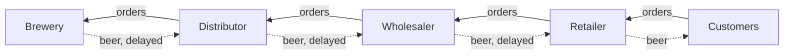
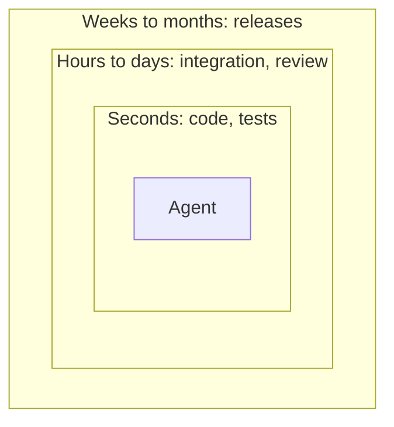

## The beer game

The beer game is a supply-chain game from Jay Forrester's system dynamics group at MIT, made famous by Peter Senge in *The Fifth Discipline*.[^senge] Four players form a chain: a retailer, a wholesaler, a distributor and a brewery. Each sees only their own stock, their backlog and the orders arriving from the player downstream. Orders and deliveries each take weeks to arrive.

Customer demand changes once, from four cases a week to eight, and then stays there. What follows is boom and bust. The retailer runs short and orders more. Nothing arrives, so they order more again. Each player upstream sees a bigger jump than the one before, and the swings grow as they travel up the chain. Then the backed-up orders arrive together, everyone is left with far too much beer, and ordering collapses. It happens almost every time the game is played, including with experienced managers.

John Sterman found out why.[^sterman] Players ignore the supply line: the beer already ordered but not yet delivered. They react to what they can see, so they correct the same shortage several times over. The swings come from the structure of the game, not from the people playing it. The players who do best count what is already on its way and are patient with the delays.

The game is just an illustration showing how quickly a system with several stages and delays between them becomes chaotic. Software teams are not immune, and working with agents exacerbates the problem.

## Software teams play the same game

Asking an agent for a change is placing an order. The delivery is the moment users, integration or production show whether the change was right. Agents make orders almost free, so far more change is in transit at once.

Unlike beer, change in transit doesn't look like it's in transit. It passes its tests, gets merged and looks finished by all the usual means of validation. *What hasn't arrived yet is understanding*. A team that steers based on outdated understanding will drive future changes on incomplete understanding many times before understanding arrives, if it ever does. Deming's funnel experiment shows where that leads: reacting to each result with a correction makes the spread worse, not better.[^deming] With agents, a correction costs as little as an order, so each one can be a large change, made on understanding that is drifting further from reality.

A change has two deliveries: knowing that it is right, and the team's theory catching up with it. The first arrives eventually, but there is no guarantee the second ever will.

| | Correctness | Theory |
|---|---|---|
| Question | Is the change right? | How was it done, and how has the system's theory moved? |
| Arrives through | Outer loops: users, integration, production | Doing the work, pairing, the theory-holders reading the code |
| Does it arrive? | Eventually, even if late | Maybe never |

## Fast inner loops, slow outer loops

Programming has many nested feedback loops, and they run at different speeds. Typing code and test-driven development take minutes. Integration, coordination and review take hours or days. Planning, releases and learning from customers take weeks or months.

Agents speed up the inner loops enormously. The outer loops are still led by people, and run at the pace people do. Different loop speeds are not a problem in themselves. The problem is the amount of change in flight that is not yet validated or not yet understood, and the cost of correcting it late. Validation arrives in time; understanding may not, and understanding is what steers the next change. When corrections are large and the feedback on them is slow, they are made on understanding that is already out of date, and fixes compound into rework.

The symptoms are already visible. Chen and Stratton studied 718 firms and found that AI agents raised lines of code, commits and pull requests by 20–30%, with no significant rise in the work shipped. Review became the bottleneck.[^chen] Faros reports larger pull requests, less review and more incidents as agent throughput rises.[^faros] Large batches with slow feedback make outcomes worse.[^reinertsen]

## Validation depends on theory

Those studies show the symptom: change piling up in flight but don't show the cause. For that I go back to Peter Naur.

Naur argued that the primary product of programming is not the code. It is the theory held in the programmers' heads: the knowledge needed to explain how the world maps onto the system, why each part is as it is, and how it can change.[^naur] Meaningful feedback from the outer loops depends on people still holding that theory. A system can pass all its tests while the people responsible for it lose the understanding they need to spot a mistaken assumption.

Theory, or whatever word you prefer, is the critical thing to keep in human heads. I argued for it in [Who Holds the Theory]().

Building theory is learning, so it is slow and sometimes painful. It is a constraint we cannot work around.

The obvious reply is that the bottleneck is just a shortage of review, and the answer is more reviewers. But reviewers can be added only as fast as they build the theory the rest of the team holds. That is Brooks's law seen from a different angle: the time new people need before they are useful is the time it takes them to build the theory.[^brooks] Review can keep an existing theory up to date, but it builds far less theory than doing, and it rarely produces the *aha* moments that come from doing the work. A reviewer learns what changed without necessarily learning why. Theory is built by doing the thing, which is the generation effect I discussed in [Who Holds the Theory]().

Adding reviewers tries to shorten the queue, but what matters more is where the queue sits. A queue in the backlog, before the work starts, is cheap: unstarted work carries no change waiting to be understood. A queue in flight is expensive: it is the beer in transit, change the team has not yet understood. The aim is to keep the queue in the backlog.

In [Who Holds the Theory]() I asked, one change at a time, who must hold the theory of a change and for how long. I separated theory-dependent decisions, which can't be made well without the theory, from theory-neutral ones, which conform to a mapping already decided. And I argued that only someone who already holds the theory can tell which is which. This essay goes from the single change to the flow of many.

## The theory-holders are the constraint

The people who hold the theory set the pace. They are a finite group that do four things:

1. sort the work
2. review a sample of the changes delegated to agents: not all of them, but enough to keep an overview and check that the changes fit their understanding of the system
3. watch outcomes
4. do the theory-dependent work themselves

In Goldratt's terms the team is the constraint, and the right thing to do with a constraint is to exploit it and subordinate everything else to it.[^goldratt] Exploiting it means spending the team's time only where the theory is needed. Subordinating to it means agents run at the pace the team can absorb, and no faster.

This system can still go awry. The danger is slow drift: each change is pulled a step towards agent autonomy, until the team is sorting faster than it can understand.

Deciding when a change is understood well enough is itself a judgement grounded in theory. The people who hold the theory decide when a change stops counting as work in flight. Passing tests or merging the code does not settle that.

What ties intake to understanding is discipline and careful adherence to process. XP teams have kept up demanding disciplines for years so I am not concerned about that. But it has to be XP's kind of discipline, built into how the work is done rather than depending on each person remembering it. The board, the limit on work in progress and the sampling are part of the routine.

This whole process is for teams capable of that discipline. If people stop caring, stop being disciplined, stop reflecting, it's game over.

## The theory of the work

Naur's theory has two sides. The world side is what the system should do which analysts, product people and users often hold in more detail than developers. The code side is how the world lands in the structure of the code which developers hold. Working with agents adds a third kind of theory, the theory of the work: what is changing, why, in what order, what is in flight, and how each piece of work has been sorted.

Agents can write the code. The theory of the work stays with people who hold the code side: telling whether a change fits an agreed pattern takes knowing the code. Letting a customer hold two subscriptions looks like removing one uniqueness check. To someone who holds the theory, that check is where the system says what a customer is.

So the people who hold the theory sort the work, as I described in [Who Holds the Theory](). Each piece of work is a visible item on a board or another information radiator, and how it will be done is a deliberate decision recorded on it: agent-led, spike-and-re-sort or pairing, the modes set out below. This is the picture of the supply line that the beer game players don't have. It puts the queue where everyone can see it.

## Two questions for every piece of work

### Does it need the theory?

A theory-neutral change conforms to well understood patterns in the codebase. Adding a field and carrying it from the model through the database to the UI, following a pattern the team has agreed, is understood before it is written. The team recognises it as something the system already handles. A team has this theory in advance of doing the work.

A theory-dependent change alters logic, architecture or design, or can't be judged without the theory. Making the change is (potentially) theory building.

### What would a mistake cost?

Whether a change can be reversed matters less than whether a mistake would be cheap to fix. That depends on five things:

- its consequence, in money, security, privacy or customer trust
- how soon it would be detected
- how far it would spread through the system
- whether any of its effects can't be undone: data changed, messages sent, money moved
- how long the code will live

Lifetime belongs on the list because code that will soon be deleted needs no lasting theory. Code that stays needs it even if nobody changes it: someone has to diagnose it when it fails, and notice when the world it maps onto has moved. Theory-dependent mistakes in long-lived code are rarely cheap, because they can stay hidden until later work exposes them, and then need expensive and unexpected rework.

## Four boxes

The two questions give four boxes. The modes are those I defined in [Who Holds the Theory]().

|                      | Cheap to fix                                                                | Expensive to fix                           |
| -------------------- | --------------------------------------------------------------------------- | ------------------------------------------ |
| **Theory-neutral**   | Agent-led: agent works to the agreed pattern (Spec-first); automated checks | Pairing, team ownership, explicit approval |
| **Theory-dependent** | Spike-and-re-sort: explore cheaply, then re-sort with what has been learnt  | Pairing, team ownership, explicit approval |

Only the top left is led by agents. An agent needs two yeses: the work must be theory-neutral and cheap to fix. Agents still appear in every other box, as the pair in Pairing, but they don't lead.

The cost column is a forecast made at sorting time, and forecasts are fallible. Predicting how far a mistake will spread is itself theory-dependent work. Both questions come down to the same human judgement, so the table is a conservative filter.

The conservative default reduces exposure to sorting mistakes, but does not make them safe. Overestimate the cost and a person does some quick, neutral work. Little is lost, and they can rethink if they were wrong. Underestimate it and an agent gets an expensive item, but the item is neutral, so it follows an agreed pattern, and if it doesn't fit, the agent is likely to struggle visibly. When in doubt, sort to the right.

Large neutral changes, such as a migration across two hundred files following an agreed pattern, go to pairing, and the cost is accepted. Theory-neutral work is usually quick, but not always. All of this rests on human judgement, and accepts that judgement is fallible.

The bottom left is mostly short-lived or exploratory code. In spike-and-re-sort, an agent builds a throwaway prototype, and the real thing can be evaluated again based on what has been learnt with the prototype as a reference.

None of this means the top left goes unchecked. The check moves earlier, to sorting, and later, to sampling and to the signals I describe below.

## Where defaults come from

Systems are made of layers and components with very different risks. Some are boilerplate, well understood and low risk, like a disposable website layout. Others are consequential: billing, identity, privacy, anything touching money or security. A map of which is which gives each piece of work a default box.

In consequential areas, people own the rules, the invariants and the design rationale. People also govern the interfaces and authority boundaries between low-risk and high-risk areas, even when they delegate the implementation.

Decisions override components, though. A theory-neutral change in billing, such as a new field following an agreed pattern, can still go to an agent. A theory-dependent change in the layout code, such as a new navigation model, still needs pairing.

## When the sorting is wrong

This approach is only as safe as its sorting, and sorting has two weaknesses. It happens before the work shows what it touches, so it is a prediction made with the least information the team will ever have about that item. And the most dangerous changes look neutral, so they are the likeliest to be sorted wrongly, sending them to the box with the least attention.

There are three signals for detecting mistakes in sorting:

| Signal                                                          | Catches                                                | When                                 |
| --------------------------------------------------------------- | ------------------------------------------------------ | ------------------------------------ |
| Agent friction: restarts, time taken, size of the change        | Neutral work that doesn't fit the agreed pattern       | During the work, an early warning    |
| Theory-holders meet the code during later theory-dependent work | Changes that behave correctly but don't fit the theory | When that area next needs the theory |
| Escaped defects                                                 | Behavioural mistakes                                   | Late, in production                  |

### During the work

An agent asked to add a field may change a validator on the way. When the work no longer matches how it was sorted, the agent should stop and say so, and its permissions should match its box. Comparing the files it touched against the files the item should touch is a useful mechanical check, but it only catches mistakes that spread. Removing a uniqueness check touches one file, the expected one.

A better signal is friction. Theory-neutral work should be cheap, so an agent that struggles with it is telling you something. Either the item was sorted wrongly, or earlier changes have eroded the pattern it was meant to follow. If there are too many restarts, or it takes too long, or the change is too big, someone who holds the theory steps in. This turns the agreed pattern into a test. It is also a way of counting what is in transit, which is what the beer game players failed to do.

Escalation has to be built in. Deming's red bead experiment shows that the system sets the defect rate, and telling people to try harder doesn't change it.[^deming] Telling reviewers to be more careful won't change an agent's error rate either.

There is no general threshold for too many restarts, too long or too big. The person who sorts an item judges what it should take, and records it. The agent should stop and say so when the work goes past that; a check on the pull request, comparing its size with what was recorded, is a backstop.

### After the work

People doing theory-dependent work notice when the code around them isn't right. This is consistent with Naur. A patch that doesn't fit the theory costs something when someone has to change that code with the theory in mind.

Some "finished" work will come back as bugs. When it does, the people who sorted it acknowledge the mistake, look at the work more critically, and re-sort and rework it as theory-dependent. Each mistake recalibrates how similar work is sorted next time. But these mistakes are found in the slowest, most expensive loop, so a wrongly sorted neutral item is paid for at the expensive rate.

That leaves a gap. A change can behave correctly but not fit the theory of the system. It causes no friction and no defect a user would notice. It surfaces only when later work runs into it, and in code that only agents touch, that may take a long time.

## Objections

*No sensible team delegates whatever an agent can do.* Many teams do, and the evidence suggests it is common: more code, more pull requests, less review and more incidents.[^chen][^faros] That is the practice I am arguing against. If your team already works this way, so much the better.

*Sorting is overhead that kills the speed agents give us.* For someone who holds the theory, sorting most items is quick. When an item is hard to sort, that is a sign it needs the theory, and an agent would do worse with it. Speed beyond what the team can understand is not speed: it is more beer in transit.

*Our tests catch the mistakes.* Tests check behaviour against what someone wrote down. They don't check whether a change fits the theory.

*A newcomer can sort if they are careful.* What is missing is knowledge, not care. Confidence makes it worse, which is the pattern I described in [AI is a Dunning–Kruger Amplifier]().

*This is change management with agents, and approval gates don't work.* It does rest on prior art, and I think that strengthens it. ITIL's standard change is pre-authorised, low risk and follows an agreed procedure, which is the top-left box.[^itil] What is different is the criterion and who applies it. ITIL sorts by risk and precedent. This sorts by whether a change needs the theory, and only people who hold the theory can apply that.

As for gates, *Accelerate* found that approval by a body outside the team slowed delivery with no gain in stability, while lightweight approval by peers inside the team did well.[^accelerate] Agent-led work has no gate here, only sorting and sampling. Where approval is needed, the approvers are developers who work alongside the agents, manage their work and read the code closely. They give an agent the trust they would give a very junior developer, whose ability and judgement are limited. The comparison stops there. Unlike a junior, an agent doesn't build the theory over time.

## Count what's already on its way

The beer game players who do best order steadily and count the supply line. For a team working with agents, the supply line is change not yet understood. The people who hold the theory judge when each change is understood well enough, and build new theory where the change requires it.

Sort each piece of work by whether it needs the theory and what a mistake would cost. Keep the queue in the backlog, where it is cheap. Let agents go as fast as the people who hold the theory can absorb, and no faster.

*See also: [TDD from a Control Theory POV]().*

---

## References

[^senge]: Senge, P. (1990). *The Fifth Discipline: The Art and Practice of the Learning Organization*. Doubleday.

[^sterman]: Sterman, J. D. (1989). Modeling Managerial Behavior: Misperceptions of Feedback in a Dynamic Decision Making Experiment. *Management Science* 35(3), 321–339.

[^deming]: Deming, W. E. (1993). *The New Economics for Industry, Government, Education*. MIT Center for Advanced Engineering Study. Funnel and red bead experiments.

[^reinertsen]: Reinertsen, D. G. (2009). *The Principles of Product Development Flow: Second Generation Lean Product Development*. Celeritas.

[^goldratt]: Goldratt, E. M. and Cox, J. (1984). *The Goal: A Process of Ongoing Improvement*. North River Press.

[^brooks]: Brooks, F. P. (1975). *The Mythical Man-Month: Essays on Software Engineering*. Addison-Wesley.

[^itil]: AXELOS (2019). *ITIL Foundation: ITIL 4 Edition*. TSO. Change enablement: standard, normal and emergency changes.

[^accelerate]: Forsgren, N., Humble, J. and Kim, G. (2018). *Accelerate: The Science of Lean Software and DevOps*. IT Revolution. Chapter on change approval.

[^naur]: Naur, P. (1985). Programming as Theory Building. *Microprocessing and Microprogramming* 15(5), 253–261. <https://pages.cs.wisc.edu/~remzi/Naur.pdf>

[^chen]: Chen, F. and Stratton, J. (2026). Artificial Intelligence in the Firm: Bottlenecks in Software Production. Harvard job-market paper. <https://fion.ac/jellyfish.pdf>

[^faros]: Faros Research (2026). The Speed Trap: 8 Takeaways From Our Latest AI Engineering Research. <https://www.faros.ai/blog/ai-speed-trap-takeaways>
